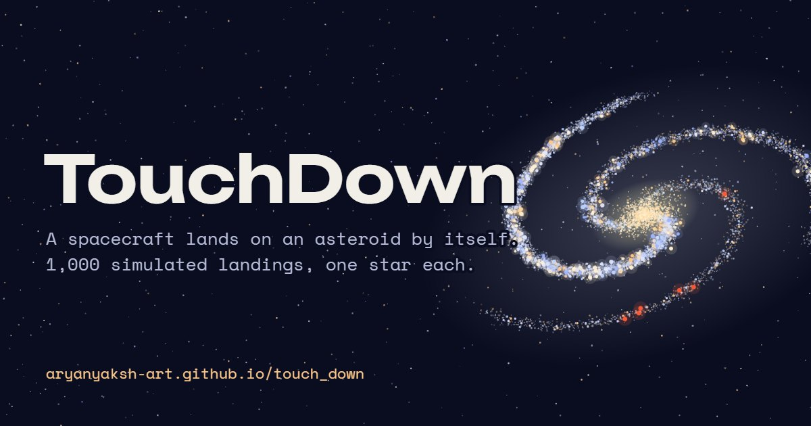
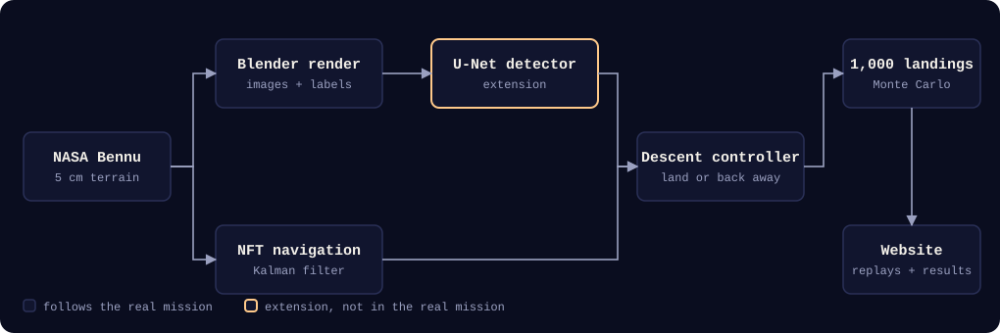

<div align="center">



# TouchDown

**A spacecraft that sees hazards, finds its position without GPS, and lands by itself.**<br>
A from-scratch recreation of the autonomous sample collection NASA's OSIRIS-REx performed at asteroid Bennu.

[](https://github.com/aryanyaksh-art/touch_down/actions/workflows/tests.yml)
[](https://aryanyaksh-art.github.io/touch_down/)


[**Live site**](https://aryanyaksh-art.github.io/touch_down/) &nbsp;·&nbsp; [Method](docs/method.md) &nbsp;·&nbsp; [Validation](docs/validation.md) &nbsp;·&nbsp; [Descent from 125 m](docs/descent_extension.md) &nbsp;·&nbsp; [Reviewer Q&A](docs/expert_prep.md)

</div>

## What this is

At Bennu, radio signals take minutes to cross the gap, so the spacecraft has to navigate and decide alone. This project rebuilds that capability end to end: it renders camera images of the real terrain, finds its position from landmarks, flies a ballistic descent, and decides at about 5 m whether to touch down or back away. It then tests the whole system with 1,000 simulated landings and compares the results with published OSIRIS-REx and Bennu data.

It follows the real mission's method first and adds one clearly labelled extension, so every part is either **faithful** or an **extension**:

| | Real OSIRIS-REx | TouchDown |
|---|---|---|
| Navigation | Natural Feature Tracking (NFT): match rendered landmarks to camera images, Kalman filter | Same method, reimplemented |
| Descent | Matchpoint burn, ballistic fall, contact at about 10 cm/s | Same |
| Hazard avoidance | Ground-built hazard map; autonomous back-away at about 5 m | Same, as the **baseline** |
| Onboard hazard detection | none | **Extension:** neural network on descent images |

<div align="center">

<br><sub>Nightingale, OSIRIS-REx's sample site, from NASA's public 5 cm terrain model. Right: the ground-truth hazards (boulders yellow, steep ground red) and the 8 m sampling zone.</sub>
</div>

## Results at a glance

Every number below has its source, intervals and caveats in [docs/validation.md](docs/validation.md). One real landing exists, so matching it shows plausibility, not equivalence.

| Question | Answer | Details |
|---|---|---|
| How accurate is the landing? | Median **0.39 m** from the aim point, **91.9%** within 1 m, 1,000 landings from 45 m (published: within about 1 m, one landing) | [validation 6d](docs/validation.md) |
| Does it predict its own touchdown? | Median **3.4 cm** off at 5 m (published: 3.5 cm) | [validation 6d](docs/validation.md) |
| What happens from the real start height (125 m)? | Median **0.68 m**, 79% within 1 m on 150 paired seeds. It is worse than from 45 m because the Matchpoint burn is realistically large, so the 45 m numbers understate delivery error. With perfect burns the median is still 0.50 m; most of that floor comes from an assumed unmodelled acceleration (removing it gives 0.15 m) | [descent extension](docs/descent_extension.md) |
| Does the neural detector help? | Only when the ground map is stale: hazard contacts 9 to 3 of 1,000 (p = 0.03), at the cost of needless back-aways rising from 7 to 72 | [validation 6b to 6f](docs/validation.md) |
| Can the false alarms be tuned away? | No: ten evidence rules and a hard-negative retraining all fail to keep the benefit while removing the cost | [validation 6e to 6g](docs/validation.md) |

## How it works

<div align="center">

</div>

1. **Terrain.** NASA's 5 cm Nightingale model becomes a height grid; hazards are rocks of 21 cm or more and slopes above 14 degrees.
2. **Camera.** Blender renders what the spacecraft's camera would see, with pixel-exact hazard labels.
3. **Navigation.** NFT renders landmark templates from an onboard terrain model, matches them to the image, and a Kalman filter turns the matches into a position.
4. **Descent.** A Matchpoint-style burn sets up a ballistic fall at 10 cm/s. At about 5 m the controller predicts the touchdown point and backs away if it is probably on a hazard.
5. **Extension.** A U-Net segments hazards in the frames and fuses them into a live hazard map.
6. **Evidence.** 1,000 landings, run on free Kaggle GPUs, compared with published data.

Details and every assumption: [docs/method.md](docs/method.md).

## Honest limitations

- **The 1,000-landing runs start at 45 m, not at the real Checkpoint (125 m).** The 5 cm terrain tile is only 48 m wide. An opt-in extension starts at 125 m over a wider terrain (the tile plus NASA's 88 cm global model, with synthetic outer boulders); see [docs/descent_extension.md](docs/descent_extension.md). The Checkpoint burn itself is not simulated.
- **The detector trades safety for needless back-aways.** Its benefit is real only with a stale ground map, and it costs about 11 extra needless back-aways per hazard avoided.
- **Several parameters are assumptions, not mission values:** the abort threshold, burn execution errors, start dispersions, the stale-map cutoff. Each is marked in the code and docs, and the sensitivity of delivery error to the burn errors is measured.
- **Low-altitude navigation is optimistic:** the simulated camera and the onboard model share a terrain source. The same holds above 54 m in the 125 m extension.
- **The navigation filter is overconfident** (documented, with a calibration sweep).

## Try it

**The site** (nothing to install): <https://aryanyaksh-art.github.io/touch_down/>. Scroll from a telescope into a galaxy of 1,000 landings, one star each; open a star for its picture and decision.

**The code** (Python 3.12+, [uv](https://docs.astral.sh/uv/)):

```bash
uv sync
uv run python scripts/fetch_data.py --global   # NASA models, about 430 MB, saved outside the repo
uv run python scripts/build_dtm.py             # 5 cm height grid of Nightingale
uv run pytest                                  # about 100 tests; also run in CI on Python 3.12 to 3.14
```

**The website** (`web/`, Vite + React + Motion):

```bash
cd web && npm install && npm run dev
```

## Reproduce the experiments

Rendering, training and the Monte Carlo are written for a free GPU (Kaggle T4 x2). Import a notebook, set the accelerator, turn Internet on, and Save and Run All. [notebooks/README.md](notebooks/README.md) lists all 18 notebooks with what each does and how long it takes; the scripts they call are described in [scripts/README.md](scripts/README.md).

## Repository map

```
touchdown/     the Python package
  bennu/         terrain loading, height grid, the wide 125 m terrain
  terrain/       hazard map, synthetic boulders
  render/        camera model, Blender worker and client, GPU ray caster
  dataset/       labelled-image generator
  vision/        U-Net, training, evaluation, hard-negative mining
  nav/           NFT: landmark templates, correlation, Kalman filter
  gnc/           dynamics, targeting burns, back-away decision
  sim/           closed-loop landing, Monte Carlo
  analysis/      comparison with published data, ablation, sensitivity, exports
configs/       physical constants and thresholds, each with its source
scripts/       data download, figures, demos, Kaggle runners, analysis helpers
notebooks/     Colab (01-04, 06) and Kaggle (05, 07-18) notebooks
web/           the website: telescope zoom, galaxy of landings, replays
docs/          method, validation, references, extension, reviewer Q&A, figures
tests/         pytest suite (runs in CI)
```

## Documentation

| Document | What it covers |
|---|---|
| [docs/method.md](docs/method.md) | What each part does, and where it departs from the real mission |
| [docs/validation.md](docs/validation.md) | How each part is checked, all results with intervals, known weaknesses |
| [docs/descent_extension.md](docs/descent_extension.md) | Descent from the real 125 m Checkpoint: the wide terrain, assumptions, paired comparison, burn-error sensitivity |
| [docs/references.md](docs/references.md) | Every published value, with its source and whether it is confirmed |
| [docs/expert_prep.md](docs/expert_prep.md) | Questions a space-robotics reviewer is likely to ask, with honest answers |
| [docs/PLAN.md](docs/PLAN.md) | The original project plan (kept for reference) |
| [CLAUDE.md](CLAUDE.md) | Working notes for the AI coding assistant used to build this: environment quirks and run books |

<details>
<summary><b>Figures</b></summary>

<br>


<sub>Rendered NavCam-style frames at 10, 25 and 50 m (top) with their labels (bottom). Labels are looked up from the 3D position under each pixel, so they register exactly.</sub>


<sub>Training terrains (centre, right): the real ground with its boulders removed and new power-law boulders injected. The real surface (left) is the test set, so the score measures transfer from synthetic to real boulders.</sub>


<sub>Open-loop navigation test: a 0.1 m/s descent from 40 m to 6 m, starting 0.55 m off. One run; caveats in [docs/references.md](docs/references.md).</sub>

</details>

## Data and credits

Terrain: NASA OSIRIS-REx Laser Altimeter shape models of Bennu, via the [NASA Scientific Visualization Studio](https://svs.gsfc.nasa.gov/5069). Method after the OSIRIS-REx Natural Feature Tracking papers (Olds et al.) and the mission's public TAG material. Rendering with [Blender](https://www.blender.org/). This is an independent educational recreation, not affiliated with NASA.

## License

[MIT](LICENSE)
